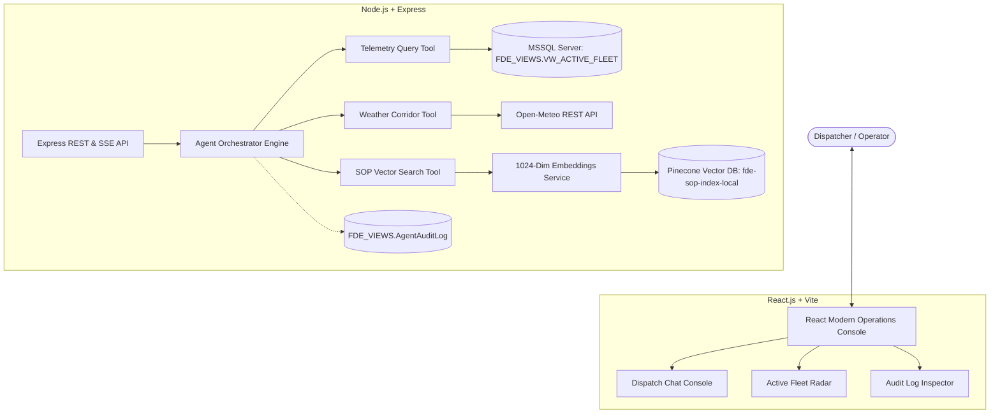

# 🧊 Cold-Chain Logistics AI Incident Control Platform

An enterprise-grade autonomous decision-support system and operations console built with **Node.js**, **React.js**, **Pinecone Vector Database**, and **MSSQL**. Designed for supply chain operations to monitor refrigerated fleets, identify cold-chain spoilage anomalies, query SOP regulations via RAG, and execute dynamic routing protocols.

---

## 🌟 Key Features

- **Autonomous Agentic Orchestration**: Multi-turn reasoning agent powered by Groq / OpenAI with automated tool selection and parameter generation.
- **1024-Dimension RAG Vector Store**: Built-in 100% free embeddings using `@xenova/transformers` (`bge-large-en-v1.5` / `bge-m3`) with Pinecone similarity search.
- **Read-Only Telemetry Security Layer**: Strict SQL read-only enforcement preventing database mutations, coupled with comprehensive audit logging in `FDE_VIEWS.AgentAuditLog`.
- **Live Corridor Disruption Telemetry**: Real-time GPS weather forecasting and congestion indexing via Open-Meteo REST API.
- **Real-Time Fleet Spoilage Radar**: Live tracking dashboard highlighting temperature violations (> 4.0°C), route risk indexes, and delay probabilities.
- **Enterprise Security Gate**: Password-protected administrative viewer for cryptographic inspection of reasoning traces and tool outputs.

---

## 🏗️ Architecture Overview



---

## 📁 Project Structure

```text
Cold-Chain-Logistics/
├── backend/                       # Node.js backend service
│   ├── package.json
│   ├── src/
│   │   ├── config/
│   │   │   ├── env.js             # Environment variable loader
│   │   ├── config/
│   │   │   ├── env.js             # Validated environment configuration
│   │   │   └── db.js              # MSSQL connection pool (Agent & Admin)
│   │   ├── services/
│   │   │   ├── embeddings.js      # 1024-dim Transformers.js (Xenova/bge-large-en-v1.5)
│   │   │   ├── pinecone.js        # SOP retrieval and vector search
│   │   │   ├── weather.js         # Real-time GPS weather & congestion risk
│   │   │   ├── telemetry.js       # Read-only query execution & 32k fleet statistics
│   │   │   └── auditLog.js        # Silent execution trace logging
│   │   ├── agent/
│   │   │   ├── prompts.js         # Business executive summary guidelines
│   │   │   ├── tools.js           # Tool schemas & parameter routing
│   │   │   └── orchestrator.js    # Multi-turn reasoning loop & SSE streaming
│   │   ├── prompts/
│   │   │   └── system_prompt.txt  # System prompt definitions
│   │   ├── routes/
│   │   │   ├── agent.js           # POST /api/agent/chat & /api/agent/stream
│   │   │   ├── telemetry.js       # GET /api/telemetry/fleet & /api/telemetry/stats
│   │   │   ├── audit.js           # POST /api/audit/logs
│   │   │   └── health.js          # GET /api/health
│   │   └── server.js              # Express app entrypoint
│   └── scripts/
│       └── ingest_sop.js          # Document chunking & Pinecone upsert
│
├── frontend/                      # React operations dashboard
│   ├── package.json
│   ├── vite.config.js
│   ├── index.html
│   └── src/
│       ├── api/
│       │   └── client.js          # REST & SSE communication client
│       ├── components/
│       │   ├── Sidebar.jsx        # Navigation shell & database health badge
│       │   ├── DispatchChat.jsx   # Real-time streaming chat with live thought timer & trace inspector
│       │   ├── PowerBIDashboard.jsx # Executive BI analytics with Recharts across 32,065 rows
│       │   ├── AuditTrail.jsx     # Security gate & SQL audit log table
│       │   └── MarkdownView.jsx   # Executive report, tables & SOP citation renderer
│       ├── App.jsx                # App shell
│       ├── index.css              # Warm stone design system (zero gradients)
│       └── main.jsx
│
├── database/                      # MSSQL database setup & security scripts
│   └── setup_security_and_view.sql # View creation, user RBAC & audit trail table
│
├── data/
│   ├── policy/                    # Standard Operating Procedures (.md)
│   ├── raw/                       # 32,065 historical cold-chain fleet records (.csv)
│   └── cache/                     # MD5 hash cache to avoid duplicate vector upserts
│
├── docs/                          # Project specifications & presentation decks
│   ├── materials/                 # Technical Design Document & Executive Presentation PDFs
│   └── instructions.md            # Step-by-step infrastructure & deployment setup
│
├── .env.example                   # Environment configuration template
├── package.json                   # Root workspace scripts
└── README.md
```

---

## 🚀 Quickstart Guide

### 1. Prerequisites
- **Node.js**: v18.0.0 or higher (`node -v`)
- **Pinecone Account**: Free vector database at [pinecone.io](https://app.pinecone.io)
- **Groq API Key**: Free LLM inference key at [console.groq.com](https://console.groq.com)
- **MSSQL Server**: Docker container or remote instance running SQL Server 2022.

---

### 2. Environment Configuration

Copy `.env.example` to `.env` in the root directory:

```bash
cp .env.example .env
```

Configure your credentials in `.env`:
```ini
# LLM Settings
Agent_llm=GROQ
GROQ_API_KEY=gsk_your_key_here
GROQ_MODEL=llama-3.3-70b-versatile

# Pinecone Vector Store
PINECONE_API_KEY=pcsk_your_key_here
Emdeddings_model=LOCAL
Local_Embeddings_Model=Xenova/bge-large-en-v1.5
PINECONE_INDEX_NAME=fde-sop-index-local

# MSSQL Database
SQL_SERVER_HOST=localhost
SQL_SERVER_PORT=1433
SQL_AGENT_USER=USR_FDE_RO
SQL_AGENT_PASSWORD=AgentPassword2026!
SQL_ADMIN_USER=sa
SQL_ADMIN_PASSWORD=FdeEnterprisePass123!
```

---

### 3. Database Setup (MSSQL)

If running a local database via Docker:
```bash
docker run -e "ACCEPT_EULA=Y" -e "MSSQL_SA_PASSWORD=FdeEnterprisePass123!" \
   -p 1433:1433 --name legacy-mssql -d mcr.microsoft.com/mssql/server:2022-latest
```

Execute `database/setup_security_and_view.sql` in SQL Server to create the read-only view `FDE_VIEWS.VW_ACTIVE_FLEET`, the agent user `USR_FDE_RO`, and the audit table `FDE_VIEWS.AgentAuditLog`:
```sql
CREATE TABLE FDE_VIEWS.AgentAuditLog (
    LogID INT IDENTITY(1,1) PRIMARY KEY,
    Timestamp DATETIME DEFAULT GETDATE(),
    SessionID VARCHAR(50),
    NodeExecuted VARCHAR(50),
    ToolName VARCHAR(100),
    Content NVARCHAR(MAX)
);

GRANT INSERT ON FDE_VIEWS.AgentAuditLog TO USR_FDE_RO;
```

---

### 4. Install Dependencies

Install all dependencies for backend and frontend with a single command:

```bash
npm run install:all
```

---

### 5. Ingest SOP Documents into Pinecone

Run the document parsing and 1024-dimension embedding script:

```bash
npm run ingest
```
This parses all compliance documents in `data/policy/`, creates the Pinecone index if needed, and indexes the chunks.

---

### 6. Run the Application

Start both the backend and frontend dev servers concurrently:

```bash
npm run dev
```

- **Frontend Console**: [http://localhost:5173](http://localhost:5173)
- **Backend API**: [http://localhost:5001](http://localhost:5001)

---

## 🧪 Testing Operational Inquiries

In the **Dispatch Console**, test these sample queries:

1. **The Domino Effect Test (Cross-Tool Interaction)**:
   > *"Find any active shipments near Los Angeles (Latitude ~33.8, Longitude ~-118.1). Check the local weather there, and tell me if the current cargo temperature violates the SOP for fresh perishables."*
   - *Expected Flow*: Calls `query_telemetry_db` -> Calls `fetch_corridor_conditions` -> Calls `search_compliance_sop` -> Synthesizes an Executive Summary with Action Plan.

2. **Policy Consultation (No-Tool / Fast Routing)**:
   > *"I'm a new dispatcher on the night shift. Can you quickly explain the difference between a Tier 1 and Tier 2 escalation?"*
   - *Expected Flow*: Calls `search_compliance_sop` and cites the relevant escalation thresholds directly.

---

## 🛡️ Security

- **Strict Read-Only SQL**: Direct table access to raw tables is denied. All AI agent queries are restricted to `SELECT` statements on authorized views.
- **Air-Gapped Audit Logging**: All LLM parameters, tool results, and responses are captured in `AgentAuditLog` and only visible behind administrator credentials.

---

## 📄 License

This project is licensed under the MIT License. Contributions and feedback are welcome!
